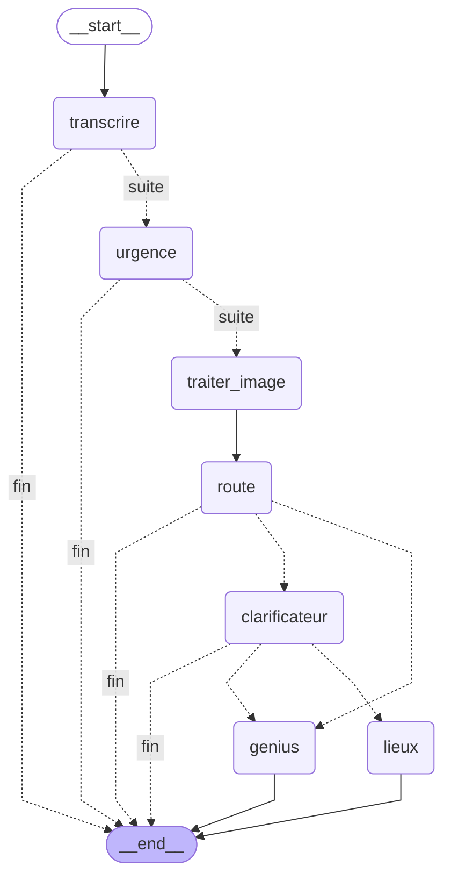

---

# MANDATORY: Post-Task Documentation (SR-PTD)

**CRITICAL: After completing ANY task that modifies files, you MUST invoke this skill:**

```
Skill tool -> skill: "sr-ptd-skill"
```

**This is NOT optional. Skipping this skill means the task is INCOMPLETE.**

When planning ANY development task, add as the FINAL item in your task list:
```
[ ] Create SR-PTD documentation
```

### Before Starting Any Task:
1. Create your task plan as usual
2. Add SR-PTD documentation as the last task item
3. This step is MANDATORY for: features, bug fixes, refactors, maintenance, research

### When Completing the SR-PTD Task:
1. Read `~/.claude/skills/sr-ptd-skill/SKILL.md` for full instructions
2. Choose template: Full (complex tasks) or Quick (simple tasks)
3. Create file: `SR-PTD_YYYY-MM-DD_[task-id]_[description].md`
4. Save to: `C:/projects/Skills/Dev_doc_for_skills`
5. Fill all applicable sections thoroughly

### Task Completion Criteria:
A task is NOT complete until SR-PTD documentation exists.

### If Conversation Continues After Task:
Update the existing SR-PTD document instead of creating a new one.

---
